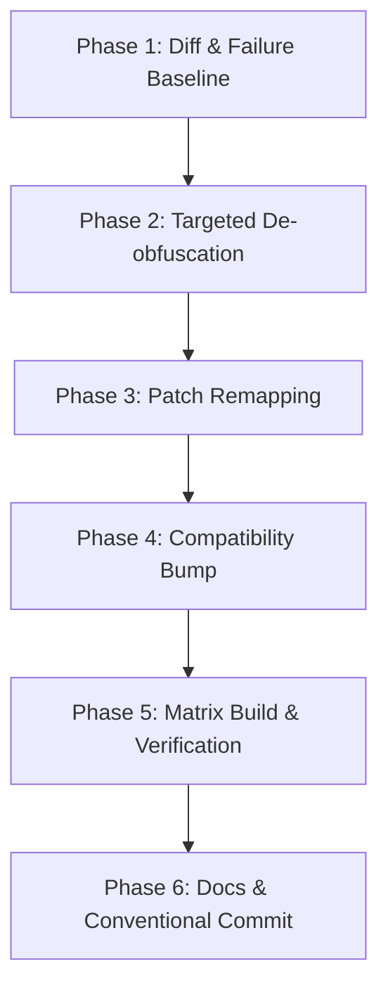

# Target App Version Upgrade Playbook

This reference provides the step-by-step protocol for upgrading supported target application versions when a new app release is published on the Google Play Store.

---

## 1. Upgrade Philosophy & Hard Invariants

1. **No Speculative Version Bumps**:
   - Never add a version string to `shared/Constants.kt` based on Play Store release notes, version scraping, or bytecode similarity alone.
   - Every version upgrade requires passing real-artifact verification with `apk-lab check` across the baseline plus all boolean option inversions.
2. **Never Weaken Assertions**:
   - Never change a required target check (`disableRequiredVoidMethodsByName`, `mutableClassDefByOrNull ?: throw PatchException(...)`) into a silent no-op just to make a check pass.
   - If an obfuscated class or method has moved, locate the new symbol and update the patch.
3. **Clean Workspace Rule**:
   - Do not manually unpack APKs into random directories. Use `apk-lab analyze` and `apk-lab check` inside managed `.apk-lab/` workspaces.

---

## 2. The 6-Phase Upgrade Workflow



### Phase 1: Diff & Failure Baseline
Compare the currently supported version against the new target version to identify architectural drifts, class renames, and failing patches:

```bash
# 1. Structural comparison: container splits, DEX counts, manifest changes, class deltas
uv run --project tools/apk-lab apk-lab compare \
  path/to/old-version.apkm \
  path/to/new-version.apkm

# 2. Force-run current patch bundle against the new APK to capture failing patches
uv run --project tools/apk-lab apk-lab check \
  path/to/new-version.apkm \
  --mpp patches/build/libs/patches-*.mpp \
  --package com.example.app \
  --all \
  --force
```
Review the failure log from `--force`. Note which specific classes, methods, or Hermes function offsets failed to resolve.

### Phase 2: Targeted Bytecode Analysis & De-obfuscation
When an obfuscated class (e.g. `LA6/c0;`) is renamed to `LB2/d1;`:
1. **Smali Extraction**:
   ```bash
   uv run --project tools/apk-lab apk-lab analyze path/to/new-version.apkm --smali
   ```
2. **Symbol Mapping via Anchors (`inspect-code`)**:
   Search the extracted Smali for unique string literals, logged tags, interface implementations, or method signature fingerprints:
   ```bash
   # Search for unique string literals in extracted code
   uv run --project tools/apk-lab apk-lab inspect-code path/to/new-version.apkm \
     --symbol "SELECT * FROM user_preferences"

   # Search for specific interface or superclass references
   uv run --project tools/apk-lab apk-lab inspect-code path/to/new-version.apkm \
     --symbol "Lcom/google/android/gms/maps/GoogleMap;"
   ```
3. **Call-Graph & Cross-Reference Mapping**:
   If string constants are missing, inspect callers of known unchanged Android SDK classes (e.g. `Landroid/app/Activity;`, `Landroid/content/SharedPreferences;`).

### Phase 3: Patch Remapping
Update the patch implementations in `patches/src/main/kotlin/app/aidan/patches/<app>/`:
- Update class descriptors (e.g. `"LA6/c0;"` $\to$ `"LB2/d1;"`).
- Update method names or parameter descriptors.
- In Hermes bundles (`index.android.bundle`), update function names or byte sequence offsets if bundle layout changed.
- In native ARM64 libraries (`lib/**/*.so`), recalculate byte offsets and branch instructions using `apk-lab asm`.

### Phase 4: Compatibility Metadata Bump
Once patch code matches the new target, update `patches/src/main/kotlin/app/aidan/patches/<app>/shared/Constants.kt`:

```kotlin
object Constants {
    const val PACKAGE_NAME = "com.example.app"

    val COMPATIBILITY_EXAMPLE = Compatibility(
        PackageName(
            name = PACKAGE_NAME,
            // Add new version string or update version range
            versions = arrayOf("2.4.0", "2.5.0", "2.6.0"),
        )
    )
}
```

### Phase 5: Build & Matrix Verification
Execute full bundle build, metadata generation, and the 5 verification gates:

```bash
# 1. Compile and regenerate public metadata
./gradlew :patches:buildAndroid
./gradlew generatePatchesList

# 2. Execute full patch permutation check
uv run --project tools/apk-lab apk-lab check \
  path/to/new-version.apkm \
  --mpp patches/build/libs/patches-*.mpp \
  --package com.example.app \
  --all
```

#### The 5 Verification Gates of `apk-lab check`:
1. **Morphe Execution**: Patch applies with exit code 0 without exceptions.
2. **Identity**: Package name and version code match expected target identity.
3. **Android DEX Verification**: Patched DEX bytecode validates cleanly via Android SDK `dexdump -c` without verification errors.
4. **Member Delta**: At least one class, method, or field was meaningfully modified by the patch.
5. **Extension Inventory**: All required extension classes from `extensions/extension.mpe` are present in output DEX.

### Phase 6: Documentation & Conventional Commit
1. **Update App Docs**:
   - Update `docs/<app>/architecture.md` with any newly discovered obfuscation patterns or architecture changes.
   - Update `docs/<app>/patches.md` if any user-facing patch options or behaviors were modified.
2. **Commit Message Format**:
   - Bumping supported target app versions **MUST** use type `bump(...)`.
   - **NEVER** use `fix` or `chore` for app version bumps.
   - Use the canonical app scope defined in `AGENTS.md` (e.g. `sezzle`, `sidelineswap`, `aftership`, `canvas-student`, `geocaching`, `fizz`, `365pay`, `adobe-scan`, `blackjack`, `navigate360-student`, `nhl`):
   ```text
   bump(sezzle): bump supported version to 14.52.0
   ```

---

## 3. Troubleshooting Common Upgrade Failures

| Failure Symptom | Probable Cause | Correct Action |
|---|---|---|
| `PatchException: Could not find class ...` | ProGuard/R8 obfuscation rename | Search for unique string literals or call sites with `apk-lab inspect-code` to identify the new class name. |
| `PatchException: Method ... not found` | Method signature changed (e.g. parameter added) | Check method overloads on the resolved classDef and inspect parameter types. |
| `DEX verification error (VerifyError)` | Dalvik register width exceeded (e.g. `v16` in format `22c`) | Use `apk-lab validate-smali` to fix register allocations ($v0 \dots v15$). |
| `Checksum mismatch on Hermes bundle` | `editor.updateFooterHash()` missing | Call `editor.updateFooterHash()` before `bundleFile.writeBytes(...)`. |
| `Member delta check failed (0 members modified)` | Patch skipped all instructions or condition was already met | Ensure the patch actually mutates bytecode; check if the vendor app changed logic or removed the feature. |
