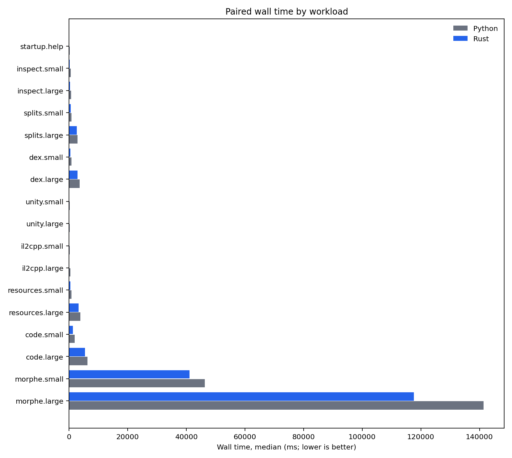
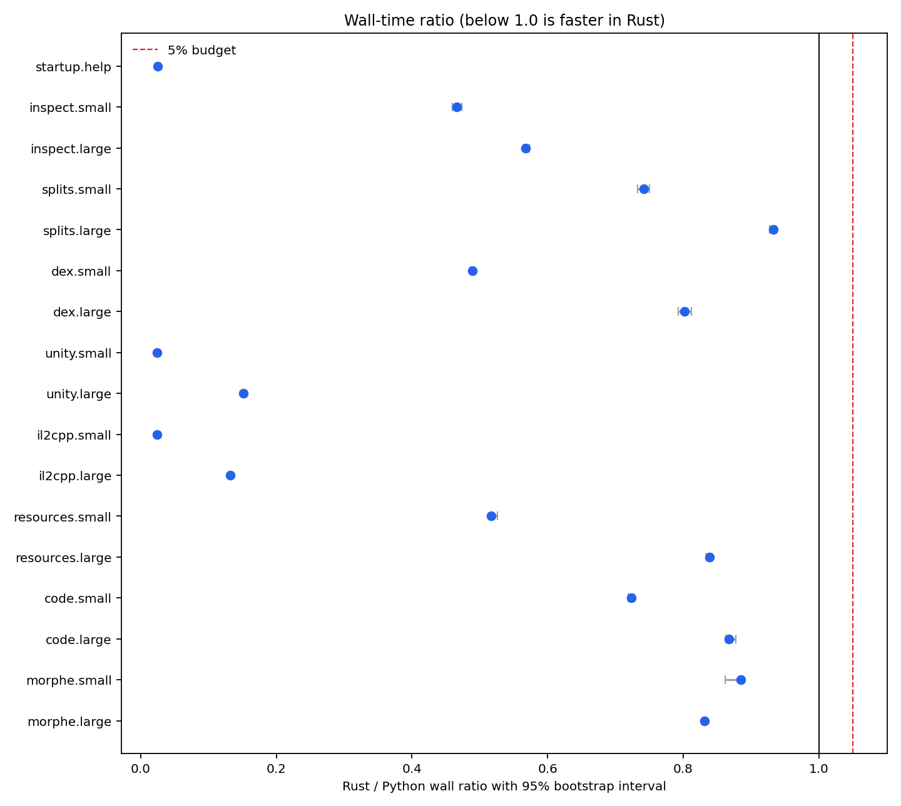

# From Python to Rust: APK Lab migration results

## Goals and non-goals

Replace the Python APK Lab implementation with a native Rust command surface while
preserving archive safety, CLI contracts, patch verification, Play delivery, R2/CI
state, and device behavior. This report records measured results; it is not a claim
that every external tool became native. JVM, Android SDK, ADB, Gradle, and Node/Bun
subprocesses remain external by design.

## Architecture

The repository now has one host crate, `tools/apk-lab`, with a library and two
binaries: production `apk-lab` and migration-only `apk-lab-migrate`. Shared owners are:

- `archives.rs`: one validated ZIP/split materialization and limit policy.
- `workspace.rs`: one managed run/marker/cleanup policy.
- `process.rs`: one shell-free subprocess and bounded-output adapter.
- `morphe.rs`: patch selection, independent option cases, execution, and postconditions.
- `acquisition.rs`, `fixtures.rs`, `compatibility_ci.rs`: delivery and durable state.
- `asset-prep`: native font, OCR, PDFBox, and icon preparation.

The Rust core and Python oracle remain independently executable; the oracle is not
linked into the candidate.

## Migration map

| Area                                        | Before            | After                           |
| ------------------------------------------- | ----------------- | ------------------------------- |
| APK/APKM/XAPK inspection and analysis       | Python            | Rust                            |
| Patch checks, deploy/dev, monitor, crash/UI | Python            | Rust                            |
| Play acquisition, accounts, R2, CI state    | Python            | Rust                            |
| Font/OCR/PDFBox/icon preparation            | Python            | Rust                            |
| README generation and hooks                 | Python            | Bun                             |
| External patch engine, signing, SDK, ADB    | JVM/Android tools | unchanged                       |
| APK Lab oracle and tests                    | Python            | retained until final retirement |

## Clean-code decisions

- One archive policy and one workspace policy, rather than per-command copies.
- One typed exit/error model and one process adapter; no shell concatenation.
- No generic plugin framework: command modules own their format semantics.
- Secrets are redacted before truncation; OAuth tokens never enter subprocess argv.
- Performance fixes removed repeated split extraction, double hashing, a 1 MiB
  `dexdump`/`aapt2` capture truncation, and full-DEX in-memory class scanning.

## Provenance

- Measured source revision: `bd3512b4bf0f89188ac81496ca3d83335662bcf2`.
- Worktree dirty at measurement: `false`.
- Policy: `tools/apk-lab/migration/performance-policy.json`
  (`7f33adfeccf23363546584d082b94af061b5173c1dc7920d2386f379da0c77d0`).
- Raw paired samples: [paired.json](docs/benchmarks/apk-lab/paired.json).
- Derived comparison: [comparison.json](docs/benchmarks/apk-lab/comparison.json).
- Host: macOS arm64, 16 logical CPUs, 32 GiB RAM.
- Python oracle: 3.12.14. Native binary: release build of the measured revision.

## Methodology

Every workload ran the direct Python `.venv/bin/python -m apk_lab.cli` oracle and the
native release binary with identical argv, inputs, options, jobs, and isolated
sandbox. Engine order alternated per sample using the pre-registered seed. Local
workloads used 5 warmups and 30 measured pairs; costly Morphe workloads used 2 and 10. Inputs and the MPP were hash-verified before timing. Outputs were validated
against declared exit codes, required text, expected files, and cross-engine
normalized output. Morphe normalization removes only `durationSeconds`,
`gitRevision`, and `toolVersions`; speedups do not skip that normalization.

Wall, CPU, and peak descendant RSS were collected with the units recorded in the raw
data. No thresholds were changed after observing results.

## Data and charts

- [paired raw data](docs/benchmarks/apk-lab/paired.json)
- [comparison summary](docs/benchmarks/apk-lab/comparison.json)
- [chart manifest](docs/benchmarks/apk-lab/charts/manifest.json)
- [wall-time chart](docs/benchmarks/apk-lab/charts/wall-time.png)
- [wall-ratio chart](docs/benchmarks/apk-lab/charts/wall-ratio.png)





The charts were rendered outside the checkout with Python 3.12.14 and
matplotlib 3.10.5:

```bash
python3.12 -m venv /tmp/to-rust-charts
/tmp/to-rust-charts/bin/pip install matplotlib==3.10.5
/tmp/to-rust-charts/bin/python render.py comparison.json docs/benchmarks/apk-lab
```

## Correctness and integration evidence

- Native APK Lab tests: 693 passed at the measured revision.
- Core parity: 8/8 with four approved native-only CLI text/flag differences.
- Analysis parity: synthetic 22/22 and real pinned tools 22/22, with one approved
  `res --json` usage-text difference.
- Patching/device parity: 21/21 offline; real AfterShip check 12/12 matches Python.
- Acquisition/CI parity: 11/11; native latest `5.25.9/52590` and older
  `5.25.8/52580` delivery.
- Isolated R2/CI run: 12/12, HTTP 200 callback, persisted submission and marker.
- Device: `emulator-5554` deploy/launch/monitor/crash-trace/UI click verified.
- Asset pipeline: exact font/OCR hashes, 112 PDFBox members, 37/37 icon pixels.
- Full audit: 38/38 checks.

## Rejected and inconclusive measurements

No workload was rejected or left inconclusive in the final accepted comparison. An
earlier run was discarded because its RSS sampler overlapped orphan processes from a
timed-out attempt; it was rerun without those processes. The discarded values are not
used in this report.

## Performance acceptance verdict

**Pass.** All 17 workloads meet the pre-registered wall, CPU, and RSS policy; no
material regression or inconclusive interval remains. Selected wall ratios
(Rust/Python; lower is faster):

| Workload          | Ratio |
| ----------------- | ----: |
| `startup.help`    | 0.025 |
| `inspect.large`   | 0.567 |
| `splits.large`    | 0.933 |
| `dex.large`       | 0.802 |
| `resources.large` | 0.839 |
| `code.large`      | 0.867 |
| `morphe.small`    | 0.885 |
| `morphe.large`    | 0.832 |

All measured workload IDs: `startup.help`, `inspect.small`, `inspect.large`,
`splits.small`, `splits.large`, `dex.small`, `dex.large`, `unity.small`,
`unity.large`, `il2cpp.small`, `il2cpp.large`, `resources.small`,
`resources.large`, `code.small`, `code.large`, `morphe.small`, and `morphe.large`.
Per-workload results, confidence intervals, and RSS verdicts are in
[comparison.json](docs/benchmarks/apk-lab/comparison.json). No single aggregate
speedup is asserted.

## Remaining Python and removal prerequisites

Python is not yet retired. The Python oracle and its test suite remain available for
final clean-checkout verification. Plan 009 must remove the Python APK Lab
implementation and dependencies, run the Python-free executable/dependency checks,
and retain the measured report as rollback evidence.

## Operational rollback and rebuild

Restore the prior Python entrypoint from the recorded source archive or revision,
then run its locked environment and tests. Rebuild the native candidate with:

```bash
cargo build --release --locked --manifest-path tools/apk-lab/Cargo.toml --bins
cargo test --locked --manifest-path tools/apk-lab/Cargo.toml
bun run audit
```

The raw paired JSON plus pass-through `compare` reproduce this verdict without
re-running the workloads.

## Limitations

External JVM/Android/SDK/ADB/Gradle and Node/Bun portions remain outside the native
binary. Network and device timings are not inferred from fixtures. The benchmark host
is one macOS arm64 workstation; Linux host capability was proven separately for Play
delivery but not for every timed workload.
