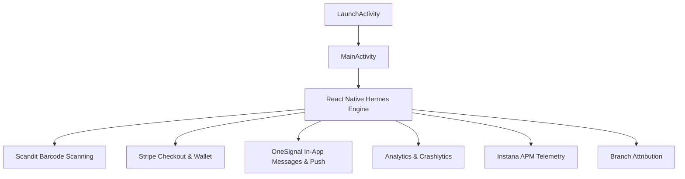

# 365 Pay Architecture & Reverse Engineering Specification

## Overview

| Attribute | Specification |
|---|---|
| **Application Name** | 365 Pay |
| **Package Name** | `com.avinside` |
| **Supported Version** | `10.2605.0` (Morphe Compatibility: `10.2605.0`, `minSdk` 27) |
| **Analyzed Version Code** | `2026519590` |
| **Target SDK** | `36` (Android 16) |
| **Minimum SDK** | `27` (Android 8.1) |
| **APK Format** | APKM (`base.apk`, `config.arm64_v8a.apk`, `config.en.apk`, `config.xhdpi.apk`) |
| **Package Signing SHA-256** | `8709f6fd781c4ba9a4f50df8c44f8c5a4ccb2fd2b114b71912e79eacf8857b1d` |
| **Architecture** | React Native with Hermes Bytecode (`assets/index.android.bundle`, HBC v96), Scandit Barcode SDK, Stripe Payment Sheet, Auth0, OneSignal SDK, Firebase (Analytics, Crashlytics), Instana APM, Branch Metrics |

365 Pay (developed by 365 Retail Markets / AV Inside) is a cashless point-of-sale and micro-market checkout application. The app combines a native Dalvik bootstrap container and hardware integrations (camera barcode scanning via Scandit, Bluetooth beacon reception, brightness elevation for kiosk barcode presentation) with a central React Native Hermes runtime.

---

## Technology Stack & Components

- **Runtime & Engine**: React Native with Hermes bytecode engine (`assets/index.android.bundle`, `lib/arm64-v8a/libhermes.so`, `lib/arm64-v8a/libreactnative.so`).
- **Entry Points**:
  - `com.avinside.LaunchActivity`: Bootstrap splash activity forwarding to main runtime.
  - `com.avinside.MainActivity`: Main React Native host activity (`com.facebook.react.ReactActivity`).
  - `com.avinside.MainApplication`: Application class configuring `ReactNativeHost` and autolinked `PackageList`.
- **Payment & Identity**:
  - Stripe SDK (`com.stripe.android.paymentsheet.PaymentSheetActivity`, `com.reactnativestripesdk.h0`).
  - Auth0 authentication (`com.auth0.android.provider.AuthenticationActivity`).
- **Scanner & Barcode Pipeline**:
  - Scandit Data Capture SDK (`com.scandit.datacapture.core`, `com.scandit.datacapture.barcode`, `lib/arm64-v8a/libscanditsdk.so`).
  - `com.avinside.BarcodeScanReceiver`: Custom native module bridge.
- **Hardware Bridges**:
  - `com.avinside.BrightnessModule`: Temporary screen brightness maximization when displaying payment barcodes to kiosk optical readers.
  - `com.avinside.BluetoothServiceModule`: BLE beacon proximity detection at micro-market kiosks.
- **Push & Engagement**:
  - OneSignal SDK (`com.onesignal`, `com.onesignal.inAppMessages`, `com.onesignal.notifications`).
  - Notifee local and scheduled notifications (`io.invertase.notifee`).
- **Marketing, Analytics & Telemetry**:
  - Firebase Analytics (`io.invertase.firebase.analytics`, `com.google.android.gms.measurement`).
  - Firebase Crashlytics (`io.invertase.firebase.crashlytics`, `com.google.firebase.crashlytics`).
  - Instana APM / End-User Monitoring (`com.instana.rn.InstanaEumModule`, `com.instana.android`).
  - Branch Metrics (`io.branch.rnbranch.RNBranchModule`).
  - In-App Review prompts (`com.ibits.react_native_in_app_review.AppReviewModule`).
  - Advertising Identifiers: Minified Google Play Advertising ID client (`Lb6/a;`, `Lb6/a$a;`) and Huawei Ad ID client.

---

## Data Flow & Architecture

---

## Hermes Bytecode & Developer Tools Architecture

All high-level business logic, state machines, and UI components reside in the compiled Hermes JavaScript bytecode bundle located at `assets/index.android.bundle` (HBC v96, 18,065,192 bytes, 85,164 functions, 121,459 strings).

### Hidden Developer & Diagnostics Screen (`EnvironmentScreen`)

- **Navigation & Trigger Gesture:**
  - Screen component: `EnvironmentScreen` (`_0x54a8cc`, function index 52517).
  - On `WelcomeScreen`, tapping the 365 Pay logo invokes `logoPress` (`_0x16a90c`, function index 53285), which increments state counter `touches`.
  - When `touches >= 5`, it invokes `goToEnvironmentSettings` (`_0x1033cf`, function index 53290), navigating to `EnvironmentScreen`.
- **Backend Environment Switcher:**
  - Dynamically fetches environment definitions from `https://tally.prod.readytouchpos.com/tallyapi/discover/listAsEnvironmentsMap`.
  - Allows switching API gateways and Auth0 authentication domains between:
    - Production: `gateway.prod.365rm.us`
    - Staging: `gateway.staging.365rm.us`
    - Test3: `gateway.test3.365rm.us`
    - Test4: `gateway.test4.365rm.us`
- **Demo Mode (`demo` / `demo_mode`):**
  - Internal diagnostic toggle enabling offline mock operations across 7 subsystem selectors:
    - Mock shopping cart responses (`getDemoCartApiResponse`).
    - Mock store transactions without processing credit card charges.
    - Fake kiosk beacon proximity detection for micro-market testing.
    - Demo messages (`getDemoMessages`).
    - Offline demo authentication bypassing Auth0 web login.
- **Debug Messages (`debug` / `debug_messages`):**
  - Internal diagnostic toggle enabling toast notification overlays on network/state transitions, verbose event telemetry, and Redux action tracing.
- **Country & Language Selectors:**
  - Dedicated navigation route (`CountrySelectionScreen`) enabling live region and regulatory rule switching (US, Canada, UK, EU, Australia).
  - Live runtime locale switcher supporting English, Spanish, French, German, Danish, Finnish, and Italian.
- **GMA & Account Creation Visibility:**
  - Controls visibility of Global Market Account self-registration.
- **App Restart:**
  - Cleanly restarts the React Native host to reload modified configuration and endpoints.

### Initial Application State Defaults

- In `_0x3844af` (function index 15766), the initial application state initializes `isDebug = false` and `demo = false`. Modifying these locations allows booting directly into Debug Messages or Demo Mode upon cold launch without manual interaction with `EnvironmentScreen`.

### Investigated Server & Location Feature Gates

- `isFavoriteDiningProductEnabled` (`_0x2f03`, function index 74367) and `isProductRecommendationEnabled` (`HomeScreen`, function index 75807) inspect `selectedLocation.locationFeatures`. Forcing these client selectors without corresponding POS catalog/menu support returns empty or 404 responses. Other commercial features (Rewards, Payroll Deduct, Auto Funding) are tied to authenticated account contracts.
